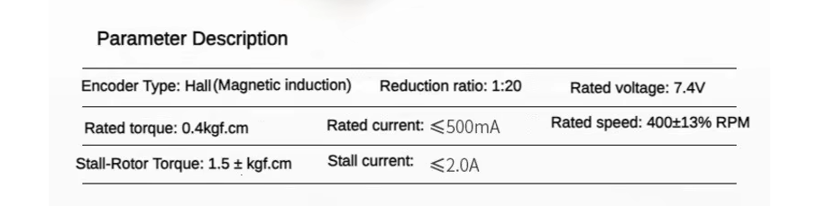

# measurement_firmware

Minimal test firmware for a **STM32G474RET6** board. The project is generated and configured with **STM32CubeMX** (`measurement_firmware.ioc`, CMake toolchain). Later this firmware will be extended to log motor readings and use them for motor modeling.

## Current pin usage

| Peripheral | Pin | Function |
|------------|-----|----------|
| TIM2 (encoder interface) | PA0 | Encoder input A (CH1) |
| TIM2 (encoder interface) | PA1 | Encoder input B (CH2) |
| LPUART1 | PA2 | TX (debug/output, 115200 baud) |
| LPUART1 | PA3 | RX |

## What it does now

- Reads the quadrature encoder via TIM2 in encoder mode.
- Every 100 ms sends over LPUART1: timestamp, encoder count delta and estimated RPM (`time,delta,rpm`).

## Wiring (MG310 motor)

```
MG310                 Motor driver / microcontroller
------                -----------------------------
Red    (M+)     --->  OUT1
Green  (M-)     --->  OUT2

Blue   (ENC VCC) --->  3.3 V
Black  (ENC GND) --->  GND
Yellow (ENC A)   --->  Encoder input A PA0
White  (ENC B)   --->  Encoder input B PA1
```

## Motor params


